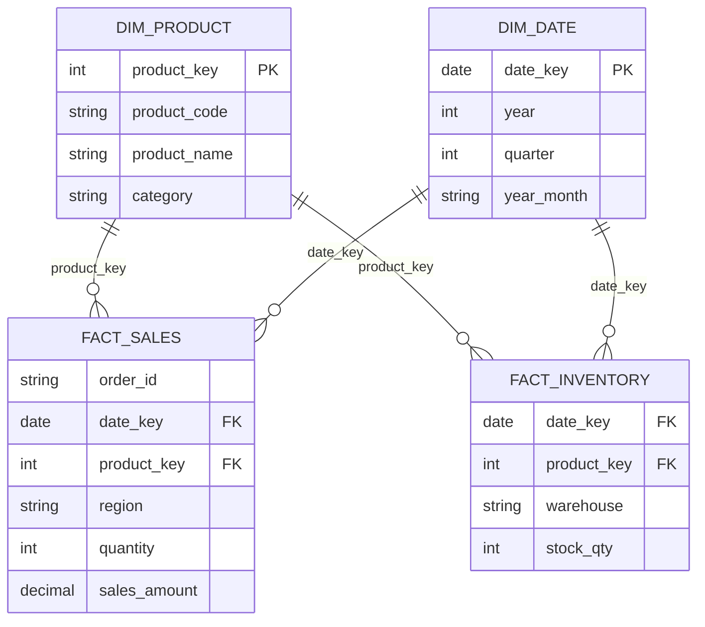
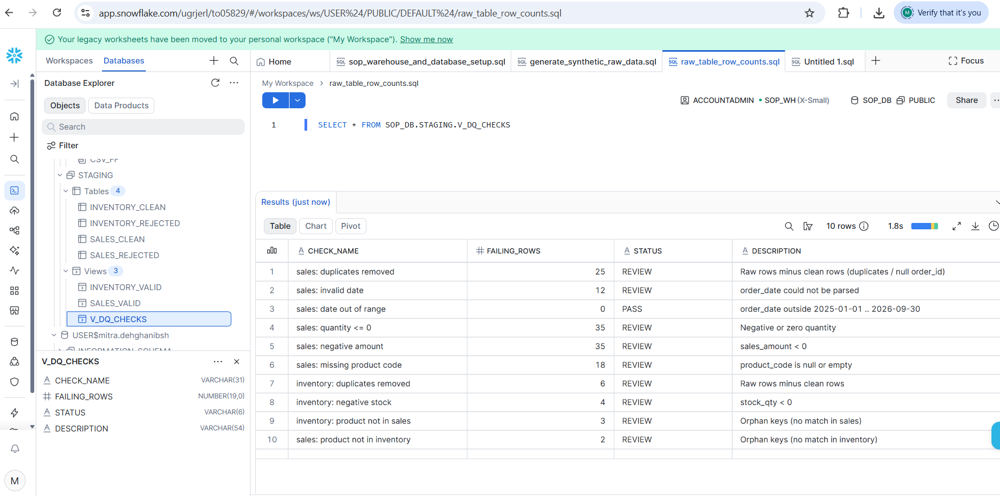
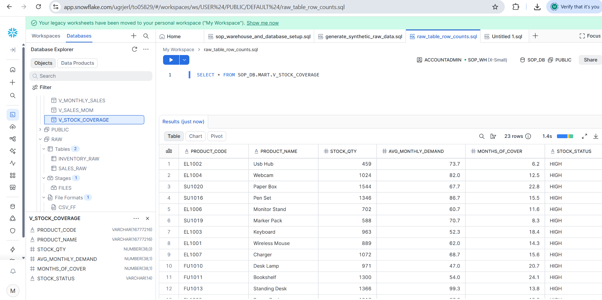

# Mini S&OP Data Model in Snowflake

A small end-to-end data project built in Snowflake to practice **data harmonization, data quality control and reusable S&OP views**. Raw sales and inventory data from two separate "source systems" is cleaned, validated, and modeled into a common star schema that supports typical Sales & Operations Planning questions.

> **Note on data:** all data is synthetic, generated directly in Snowflake with SQL (`GENERATOR`, `UNIFORM`, `RANDOM`). Data quality problems (duplicates, invalid dates, negative values, missing keys, inconsistent product codes, orphan keys) were injected deliberately to test the pipeline.

## Architecture

```
RAW (as received)  ->  STAGING (cleaned, typed, validated)  ->  MART (common model + S&OP views)
```

| Layer | Schema | Content |
|---|---|---|
| Raw | `RAW` | `SALES_RAW`, `INVENTORY_RAW` - all columns as VARCHAR, nothing rejected |
| Staging | `STAGING` | `SALES_CLEAN`, `INVENTORY_CLEAN`, quarantine tables `*_REJECTED`, views `*_VALID`, `V_DQ_CHECKS` |
| Mart | `MART` | `DIM_PRODUCT`, `DIM_DATE`, `FACT_SALES`, `FACT_INVENTORY` + S&OP views |

## Data model



`DIM_PRODUCT` is built from **both** sources, so sales and inventory share one harmonized product definition.

## Key design decisions

- **Product code standardization:** codes arrive as `EL1001`, `el1001`, ` EL1001 `, `EL-1001`. They are normalized with `UPPER(REGEXP_REPLACE(TRIM(code), '[^A-Za-z0-9]', ''))` so both sources join on one key.
- **Safe type conversion:** `TRY_TO_DATE`, `TRY_TO_NUMBER`, `TRY_TO_DECIMAL` turn bad values into NULL instead of failing the load.
- **De-duplication:** `QUALIFY ROW_NUMBER() OVER (...) = 1` keeps the latest loaded row per business key.
- **Quarantine instead of delete:** invalid rows are kept in `STAGING.SALES_REJECTED` / `INVENTORY_REJECTED` with a `reject_reason`, so nothing disappears silently.
- **Reconciliation:** clean rows = rows loaded to fact + rejected rows (difference = 0).

## Data quality checks (`STAGING.V_DQ_CHECKS`)

| Check | Rows found |
|---|---|
| Sales duplicates removed | 25 |
| Sales invalid date | 12 |
| Sales missing product code | 18 |
| Sales quantity <= 0 | 35 |
| Sales negative amount | 35 |
| Inventory duplicates removed | 6 |
| Inventory negative stock | 4 |
| Inventory product not in sales (orphan) | 3 |
| Sales product not in inventory (orphan) | 2 |
| Sales date out of range | 0 |

(Numbers vary slightly between runs because the data generator uses `RANDOM`.)
## Screenshots

**Data quality checks**



**Stock coverage view**


## S&OP views

- `MART.V_MONTHLY_SALES` - monthly quantity and sales per product
- `MART.V_STOCK_COVERAGE` - latest stock vs. average monthly demand (last 3 full months), with status `LOW` / `OK` / `HIGH` / `NO DEMAND DATA`
- `MART.V_SALES_MOM` - month-over-month growth using `LAG()`

## How to run

1. Run `mini_sop_project.sql` sections 0-1 (warehouse, database, schemas, raw tables).
2. Run `generate_raw_data.sql` to generate the sample data.
3. Run the remaining sections of `mini_sop_project.sql` in order (staging, data quality, mart, views).

## Snowflake features practiced

Virtual warehouses (auto-suspend), schemas, `GENERATOR`, `QUALIFY`, `TRY_*` functions, window functions, views, `MERGE`, zero-copy `CLONE`, Time Travel / `UNDROP`, `VARIANT` + `FLATTEN`.

## Possible next steps

- Load real files with stages and `COPY INTO`
- Incremental loads with `MERGE`, streams and tasks
- Add a forecast fact table and a forecast-vs-actual view
- Connect the views to a BI tool (e.g. Power BI)
